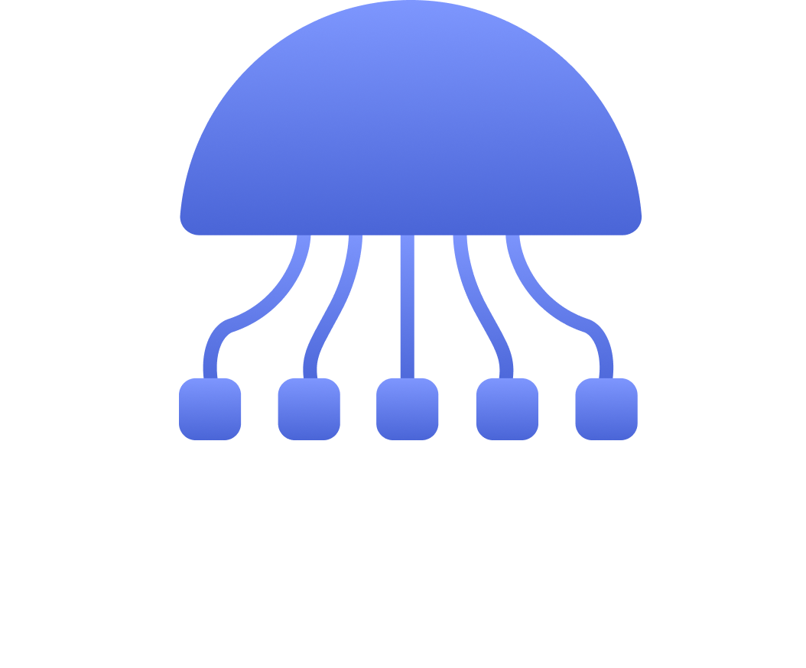
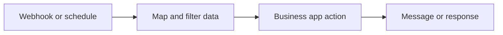

<p align="center">
  
</p>

<h1 align="center">Dominofy</h1>
<p align="center"><strong>Connect your apps. Build your workflow. Set it in motion.</strong></p>
<p align="center">A visual workflow automation platform with AI-assisted building, business app integrations, and an extensible execution engine.</p>

<p align="center">
  <a href="#getting-started">Get started</a> ·
  <a href="docs/architecture.md">Architecture</a> ·
  <a href="CONTRIBUTING.md">Contribute</a> ·
  <a href="https://github.com/revel-um/dominofy/issues">Report an issue</a>
</p>

<p align="center">
  
  
  
  
  <a href="https://github.com/revel-um/dominofy/stargazers"></a>
</p>

## What is Dominofy?

Dominofy helps technical and operations teams connect business applications through a visual canvas. Workflows are built from **dominos**: configurable triggers, actions, queries, and data-processing steps. Connect their inputs and outputs to turn a business process into an executable workflow.

Use the visual editor to assemble a workflow, or use the Gemini-powered AI service to help generate and revise one. The TypeScript backend handles execution, provider connections, scheduling, and workflow logs.

**Project status:** actively evolving. Local setup requires PostgreSQL, Redis, and your own OAuth applications. AI features require a Google API key. Integration availability depends on provider permissions and configuration; this repository does not include hosted-service credentials or a production support guarantee.

## Why Dominofy?

- **Build visually:** compose connected nodes on a React Flow canvas and configure each step in context.
- **Build with AI:** generate and revise workflow definitions with a separate Python service backed by Gemini and a domino reference catalog.
- **Connect business tools:** combine messaging, HTTP APIs, and Google Workspace integrations.
- **Control the flow:** use conditions, filters, iterators, switches, delays, mapping, code, and SQL steps.
- **Inspect automations:** work with workflow revisions, execution logs, projects, and workspaces.
- **Extend the platform:** add domino components and their matching backend handlers in a TypeScript monorepo.

## Integration catalog

The repository includes domino definitions and backend modules for these providers. Each needs its own connection setup; triggers, actions, and queries vary by provider.

| Category | Providers and capabilities |
| --- | --- |
| Google Workspace | Gmail, Drive, Calendar |
| Collaboration | Slack |
| APIs | HTTP calls and webhooks |
| Data and logic | SQL, workspace storage, CSV/Excel, mapping, filtering, branching, code |
| AI | LLM steps and AI-assisted workflow generation |

Browse the [domino catalog](apps/web/dominos/dominos.ts) and [execution registry](apps/backend/src/domino-engine/registry.ts) for implementation details.

## What can you build?

These are example compositions to configure in the editor, rather than bundled one-click templates:

- **Lead handoff:** receive a webhook, map its fields, call a CRM API, and notify a Slack channel.
- **Scheduled reporting:** run a scheduled query, filter the results, and send a summary by email.
- **AI-assisted triage:** receive an input, process it with an LLM step, branch on the result, and call a downstream API.



## Getting started

Use **Node.js 22**, **npm 10.9.2**, **Python 3.11**, PostgreSQL, and Redis. Docker is useful for running local infrastructure.

```bash
git clone https://github.com/revel-um/dominofy.git
cd dominofy
npm ci
```

Then follow the [local setup guide](docs/getting-started.md) to configure credentials, start infrastructure, and launch the services.

| Service | Local address |
| --- | --- |
| Web application | http://localhost:3000 |
| Backend API | http://localhost:3001/api/v1 |
| AI service, using the guide's port | http://localhost:8001/ping |

## Repository layout

```text
apps/web/                       Next.js editor, app UI, and domino components
apps/backend/                   NestJS API, integrations, and workflow engine
apps/ai/                        FastAPI workflow generation service
packages/ui/                    Shared UI package
shared/                         Shared pipeline types and helpers
```

## Documentation

- [Local setup and troubleshooting](docs/getting-started.md)
- [System architecture and extension points](docs/architecture.md)
- [Contributing](CONTRIBUTING.md)
- [Security reporting](SECURITY.md)

## Contributing and support

Bug reports, clearer documentation, integration fixes, and focused pull requests are welcome. Start with the [contribution guide](CONTRIBUTING.md); use [GitHub Issues](https://github.com/revel-um/dominofy/issues) for reproducible bugs and feature proposals. Never include credentials or private workflow data in a report.

If Dominofy is useful to you, **star the repository** to help other builders discover it. Sharing a reproducible workflow or improving setup instructions also helps the project grow.

## License

This repository does not currently declare a project-wide license; the backend package is marked `UNLICENSED`. Public visibility alone does not grant permission to use, modify, or redistribute the code. A project license needs to be selected by the maintainers. Third-party dependencies retain their own licenses.
