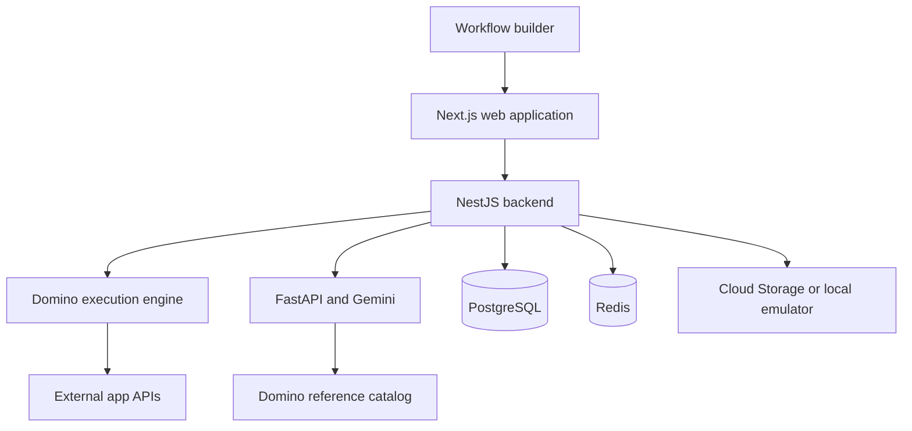

# Architecture

Dominofy separates the workflow editor, execution backend, and AI generation service. npm workspaces and Turborepo manage the Node applications; Python runs independently.

## Web application

`apps/web` contains the Next.js application, authentication routes, React Flow editor, and configurable domino components. `apps/web/dominos/dominos.ts` describes the available catalog entries. Each domino exposes fields and connection points for workflow data.

## Backend and execution

`apps/backend` contains NestJS modules for users, projects, workspaces, workflows, revisions, provider connections, scheduling, and logging. The `src/domino-engine` directory contains graph handling, the runner, the registry, and individual domino handlers. Shared pipeline helpers and types live under `shared`.

PostgreSQL stores application state. Workspace storage uses shared tenant tables with JSONB documents and application-level workspace checks; see the [storage design notes](../apps/backend/src/storage/README.md). Redis supports backend runtime infrastructure, including queues. File storage uses Google Cloud Storage or the local development emulator.

## AI workflow service

`apps/ai` is a FastAPI service with generation and streaming endpoints. Its workflow generation path plans needed domino types, retrieves reference definitions, and generates structured workflow output through Gemini. It uses the domino reference catalog and includes context handling. It is a separate process and is not launched by npm workspaces.

## Credentials and URLs

The backend loads `.env` through NestJS ConfigModule; Next.js loads web environment files. The AI service loads its own `.env`. See the [setup guide](getting-started.md) for service-specific configuration and local ports.

Provider authentication has provider-specific scopes, callback routes, and webhook requirements. Signing in does not automatically configure every workflow integration.

## Adding a domino

1. Study a similar component under `apps/web/dominos` and its corresponding backend handler.
2. Add the editor component and catalog entry using the existing field and connection conventions.
3. Implement and register the execution handler under `apps/backend/src/domino-engine`.
4. Add provider connection handling if the domino needs external credentials.
5. Update the AI reference definitions in `apps/ai/domino_reference.json` when AI generation should support the new type.
6. Test input validation, output shape, failed provider calls, and workspace boundaries where relevant.

Keep the catalog, editor representation, execution registry, and AI reference aligned.
